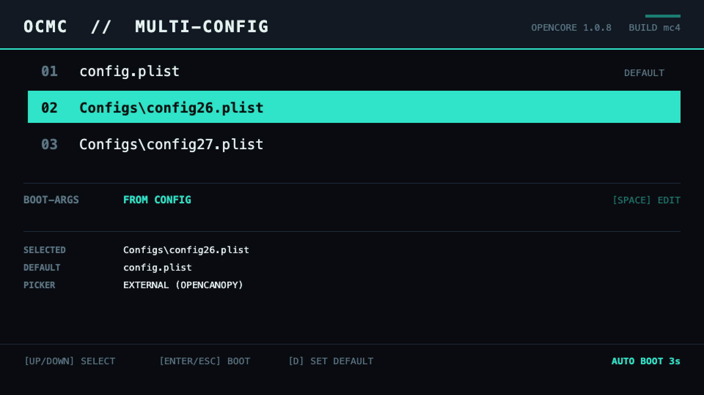

# OpenCore Multi-Config (OCMC)

A source-level modification of **OpenCore 1.0.8** that adds two things Clover users have
always had and OpenCore does not: **boot-time configuration selection** and **temporary
`boot-args` editing**.

OpenCore resolves exactly one configuration file, at a fixed path, before anything else
happens. OCMC hooks in *before* that read, so the whole initialisation chain — drivers,
NVRAM, ACPI, kernel injection — is built from whichever file you picked. No re-init, no
half-applied state.



---

## English

### Features

- **Multiple configurations, picked at boot.** `EFI/OC/config.plist` plus every
  `EFI/OC/Configs/*.plist` shows up in a graphical menu. Each file is fully independent:
  its own SMBIOS, kexts, quirks, drivers, boot-args.
- **Temporary boot-args.** Press `SPACE` on an entry, edit the arguments, boot. The value
  is written to NVRAM as a **volatile** variable after `OcLoadNvramSupport`, so it applies
  to that one boot and disappears on the next one. Your `config.plist` is never touched.
- **Per-entry arguments.** Switching entries shows that entry's own `boot-args` (read from
  its plist), and an edit only applies to the entry you finally boot.
- **Validate before boot.** A selected plist is parsed with `OcConfigurationInit` first; a
  broken file leaves you in the menu instead of OpenCore's `CpuDeadLoop`.
- **Graphical menu.** Drawn straight into the GOP framebuffer with an embedded 8×16 bold
  bitmap font, so it looks identical at any resolution. Falls back to the firmware text
  console automatically when no suitable framebuffer exists.
- **Zero cost when unused.** No `Configs` directory → no menu, no delay, stock behaviour.

### Boot-args editor


The field is a single scrolling line: the tail that fits is shown, `<` marks hidden text on
the left, and the length is displayed underneath. Long argument lists never wrap and never
push the rest of the screen around.

### Key bindings

| Key | Action |
|---|---|
| `UP` / `DOWN`, `1`–`9` | Select an entry |
| `ENTER` / `ESC` | Boot the selected entry (validated first) |
| `SPACE` / `E` | Edit that entry's `boot-args` |
| `ENTER` / `ESC` in the editor | Save and return |
| `CTRL+Z` in the editor | Discard the edit |
| `D` | Pin the selected entry immediately (it is remembered on boot anyway) |

### Remembering the last boot

The entry you boot is written to the NVRAM variable `OC-ConfigDefault` right after
selection, before the configuration is parsed. On the next boot that entry is
preselected, marked `LAST USED`, and booted when the countdown runs out — you only
have to pick a different configuration when you actually want one.

Two details worth knowing:

- The write is skipped when the selection already matches, so the NVRAM cell is not
  rewritten on every single boot.
- If the remembered file was deleted or no longer parses, the countdown falls back to
  the first entry instead of handing OpenCore an unreadable path.

To skip the menu entirely, drop an empty file named `.quiet` into `EFI/OC/Configs/`;
the menu then only appears if you hold `ESC` during handoff.

### How it works

Two insertion points, and nothing else:

| File | Change |
|---|---|
| `Library/OcMainLib/OpenCoreConfigMenu.c` | New. Enumeration, input, per-entry state, NVRAM plumbing |
| `Library/OcMainLib/OpenCoreConfigGfx.c` | New. GOP renderer and embedded font blitting |
| `Library/OcMainLib/OpenCoreConfigFont.h` | New. 95-glyph 8×16 bold bitmap font |
| `Library/OcMainLib/OpenCoreMisc.c` | `OcMiscEarlyInit` reads a resolved path instead of the fixed one |
| `Application/OpenCore/OpenCore.c` | Applies the boot-args override after `OcLoadNvramSupport` |
| `Library/OcMainLib/OcMainLib.inf`, `Include/.../OcMainLib.h` | Wiring |

The full diff against upstream 1.0.8 is in [`patches/ocmc-1.0.8.patch`](patches/ocmc-1.0.8.patch)
(8 files, ~2900 lines, includes the three new sources). It applies cleanly to a pristine
1.0.8 tree:

```bash
git apply patches/ocmc-1.0.8.patch
```

To move the changes onto a newer upstream release, see
[`docs/upstream-sync.md`](docs/upstream-sync.md) — the short version is
`./tools/sync-upstream.sh 1.1.0`, which replays the OCMC commit on top of the new tag
and regenerates the patch. This repository is not a GitHub fork of OpenCorePkg by design;
the upstream baseline lives in a local git repository (`源码/ocmc-git`, tags
`upstream-*` / `ocmc-*`) rather than in a fork relationship.

### Build

```bash
# toolchain expected in ../toolchain/bin: nasm, mtoc, iasl
./build-ocmc.sh DEBUG      # or RELEASE
```

The build uses a trimmed `OpenCorePkg-mc.dsc` that contains only the OpenCore module, so
the OpenSSL and network submodules are not required.

### Install

```bash
sudo ./install-ocmc.command        # mounts the boot ESP, backs up, copies, verifies SHA-256
```

Or by hand: copy `out/DEBUG/OpenCore.efi` over `EFI/OC/OpenCore.efi`, then create
`EFI/OC/Configs/` and drop your alternative plists in.

### Verify a configuration (`ocvalidate`)

The archive ships **`ocvalidate`**, the official OpenCore 1.0.8 configuration
checker (universal binary, x86_64 + arm64, no external dependencies). Run it
against every plist before booting:

```bash
./ocvalidate "/Volumes/EFI/EFI/OC/config.plist"
./ocvalidate "/Volumes/EFI/EFI/OC/Configs/"*.plist
```

`No issues found` means the file matches the 1.0.8 schema. Anything else means
missing or illegal keys — fix those before the file goes near the boot menu.

简体：压缩包内附官方 `ocvalidate`（与 OpenCore 1.0.8 配套，x86_64 + arm64 通用二进制，
无外部依赖）。改完配置先跑一遍，只有输出 `No issues found` 才算合格。

### Notes and limits

- `Misc → Security → Vault` must be `Optional` or `Basic`. `Secure` hashes every file in
  the OC directory, so newly added `Configs/*.plist` would be rejected.
- The menu runs before `OpenUsbKbDxe` is loaded, so keyboard input relies on the firmware's
  own USB legacy or PS/2 support. If nothing responds, the countdown still boots the default.
- Create `EFI/OC/Configs/.quiet` to skip the 3-second countdown (hold `ESC` to open the menu).
- Create `EFI/OC/Configs/.trace` to append key events and override results to
  `EFI/OC/ocmc-trace.log`, which is the fastest way to debug a "key does nothing" report.
- The menu is ASCII only: the embedded font covers `0x20`–`0x7E`.

### Credits

- Font glyphs derived from **Tamzen 8×16 Bold** (a Tamsyn derivative by Suraj N. Kurapati
  and Scott Fial), distributed under its own permissive licence — see `LICENSES/Tamzen.txt`.
- Built on **OpenCorePkg** by the Acidanthera team, BSD-3-Clause.
- The picker-entry protocol patterns were studied from `Platform/ToggleSipEntry`.

---

## 中文

**OpenCore Multi-Config（OCMC）** 是 OpenCore 1.0.8 的源码级改动，补上两件 Clover 早就有、
OpenCore 一直没有的事：**开机自选配置文件** 和 **临时改 `boot-args`**。

OpenCore 只认一个固定路径的配置文件，而且在一切初始化之前就读掉它。OCMC 把选择插在
那次读取**之前**，所以驱动、NVRAM、ACPI、内核注入全部基于你挑的那份文件——不需要回滚
半轮初始化，也不存在"改了一半"的中间状态。


### 功能

- **多配置开机自选**：`EFI/OC/config.plist` 加上 `EFI/OC/Configs/*.plist` 里的每一份都会
  出现在图形菜单里。每份配置完全独立——自己的 SMBIOS、kexts、quirks、drivers、boot-args。
- **临时启动参数**：在某项上按 `SPACE` 改参数再启动。值会在 `OcLoadNvramSupport` 之后以
  **volatile** 属性写入 NVRAM，只对本次启动生效，重启自动消失，**不碰你的 config.plist**。
- **按配置各自记忆**：切到哪一项就显示那项自己的 `boot-args`（从它的 plist 里读），编辑只
  作用于你最终启动的那一项。
- **启动前校验**：选中的 plist 会先过一次 `OcConfigurationInit`，坏的配置把你留在菜单里，
  而不是掉进 OpenCore 的 `CpuDeadLoop`。
- **图形界面**：直接画进 GOP 帧缓冲，内嵌 8×16 粗体点阵字体，任何分辨率下都是同一套像素。
  没有可用帧缓冲时自动退回固件文本控制台。
- **不用时零开销**：没有 `Configs` 目录就没有菜单、没有延迟，行为与原版完全一致。

### boot-args 编辑器


输入框是单行滚动窗口：只显示放得下的尾部，左边 `<` 表示还有内容被折叠，长度在下方单独
报出来。再长的参数列表也不会折行、不会把整屏顶乱。

### 按键

| 按键 | 作用 |
|---|---|
| `↑` / `↓`、`1`–`9` | 选择配置 |
| `ENTER` / `ESC` | 启动选中项（先校验） |
| `SPACE` / `E` | 编辑该项的 `boot-args` |
| 编辑器内 `ENTER` / `ESC` | 保存并返回 |
| 编辑器内 `CTRL+Z` | 放弃本次修改 |
| `D` | 立即固定当前项（其实启动时已经自动记住） |

### 记住上次启动

选中之后、解析配置之前，所选的项就会写进 NVRAM 变量 `OC-ConfigDefault`。下次开机会
预先选中它、标上 `LAST USED`，倒计时走完直接启动 —— 只有真想换的时候才需要动手选。

两个细节：

- 选中项与已存值相同就不写，避免每次开机都去擦写同一个 NVRAM 单元。
- 记住的那份文件被删掉或解析不了时，倒计时结束后会回退到第一项，而不是把坏路径丢给
  OpenCore 造成黑屏。

想完全跳过菜单，在 `EFI/OC/Configs/` 下放一个空文件 `.quiet`，之后只有开机时按住
`ESC` 才会出现菜单。

### 原理

只动两个接缝，别的一行不改：

| 文件 | 改动 |
|---|---|
| `Library/OcMainLib/OpenCoreConfigMenu.c` | 新增。枚举、输入、按项状态、NVRAM |
| `Library/OcMainLib/OpenCoreConfigGfx.c` | 新增。GOP 渲染与点阵绘制 |
| `Library/OcMainLib/OpenCoreConfigFont.h` | 新增。95 字形 8×16 粗体点阵 |
| `Library/OcMainLib/OpenCoreMisc.c` | `OcMiscEarlyInit` 改为读取解析出来的路径 |
| `Application/OpenCore/OpenCore.c` | 在 `OcLoadNvramSupport` 之后覆写 boot-args |
| `Library/OcMainLib/OcMainLib.inf`、`Include/.../OcMainLib.h` | 接线 |

对上上游 1.0.8 的完整 diff 见 [`patches/ocmc-1.0.8.patch`](patches/ocmc-1.0.8.patch)。

### 编译

```bash
# 工具链放在 ../toolchain/bin：nasm、mtoc、iasl
./build-ocmc.sh DEBUG      # 或 RELEASE
```

编译用的是裁过的 `OpenCorePkg-mc.dsc`，只含 OpenCore 模块本身，因此不需要 OpenSSL
和网络栈那些子模块。

### 安装

```bash
sudo ./install-ocmc.command        # 挂载启动盘 ESP、备份、覆盖、SHA-256 校验
```

手工装也行：把 `out/DEBUG/OpenCore.efi` 覆盖到 `EFI/OC/OpenCore.efi`，然后建
`EFI/OC/Configs/`，把备选 plist 丢进去。

### 限制

- `Misc → Security → Vault` 必须是 `Optional` 或 `Basic`。`Secure` 会校验 OC 目录下每个
  文件的哈希，新加的 `Configs/*.plist` 不在清单里会被直接拒绝。
- 菜单跑在 `OpenUsbKbDxe` 加载之前，键盘依赖固件自带的 USB legacy 或 PS/2。真按不动时，
  倒计时也会正常走默认项，不会卡死。
- 建 `EFI/OC/Configs/.quiet` 可跳过 3 秒倒计时（开机按住 `ESC` 仍可进菜单）。
- 建 `EFI/OC/Configs/.trace` 会把按键事件和覆写结果追加到 `EFI/OC/ocmc-trace.log`，
  排查"按键没反应"这类问题最快。
- 界面只支持 ASCII：内嵌字体覆盖 `0x20`–`0x7E`。

### 致谢

- 字形取自 **Tamzen 8×16 Bold**（Tamsyn 衍生，作者 Scott Fial / Suraj N. Kurapati），
  使用其自带的宽松许可，见 `LICENSES/Tamzen.txt`。
- 基于 Acidanthera 的 **OpenCorePkg**（BSD-3-Clause）。
- 选择器条目协议参考了 `Platform/ToggleSipEntry` 的写法。

---

## License

Code: BSD-3-Clause, same as OpenCorePkg.
Embedded font: Tamzen/Tamsyn permissive licence (see `LICENSES/Tamzen.txt`).
